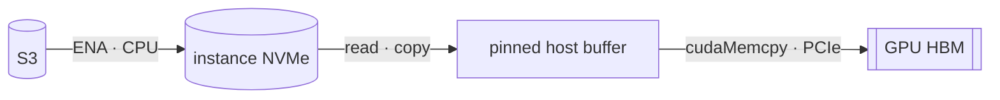
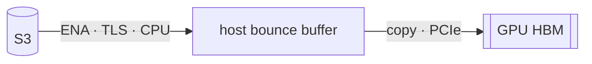
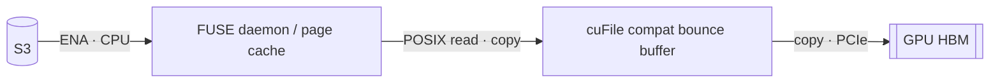
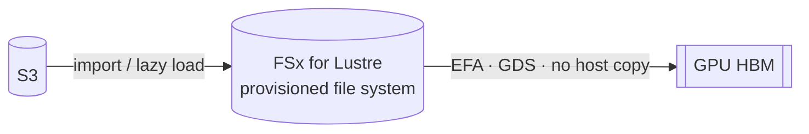
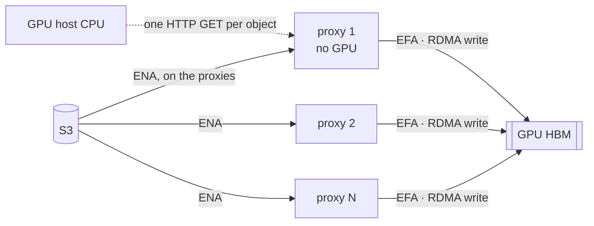
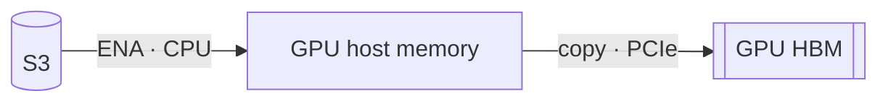
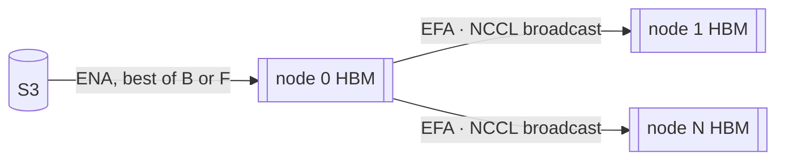

# Getting S3 data into GPU memory on AWS: the paths

Every path below ends with the same bytes in GPU memory. They differ in what they ask of the
GPU host on the way there:
- how many times the bytes are copied;
- which network carries them;
- how much of the host's CPU and memory bandwidth they consume;
- what has to be stored, and paid for, in between.

adit is one of these paths. It is a very good fit for a certain shape of problem, not for every
problem; [The shape adit fits](#the-shape-adit-fits) says which. The measured comparison is in
[results.md](results.md). Paths A–D, F and G have not been run yet; these diagrams describe
their mechanisms, not their performance.

**Legend.** Every diagram uses the same markings:
- **Network:** **ENA** is the instance's ordinary network; **EFA** is its RDMA fabric. On a
  p5en.48xlarge, ENA is 200 Gb/s and EFA is 3,200 Gb/s.
- **Copy:** a hop marked *copy* passes through GPU-host memory.
- **CPU:** a hop marked *CPU* runs on the GPU host's cores.

## A. Copy, then upload

`s5cmd` downloads to local NVMe, then a reader stages the data through pinned host memory into
the GPU. The full dataset is written to disk before the first byte reaches the GPU. Its costs
are a staging store sized to the dataset, two copies on the host, and the client's ENA as the
ceiling.

## B. Streaming loader (KvikIO RemoteFile, S3 Connector for PyTorch)

No disk, but every byte crosses the GPU host's TCP/TLS stack and a host bounce buffer. The
ceiling is the client's ENA. On a p5en, our best tuned point reached 97–105 Gb/s into 8 GPUs, at
about 144 CPU-seconds per 64 GiB (#54).

## C. FUSE mount + cuFile compatibility mode (Mountpoint, lith)

A filesystem view of the bucket. In compatibility mode, cuFile falls back to POSIX reads through
a bounce buffer. It makes the most copies of any path, and it still sits behind the client's ENA.

## D. FSx for Lustre with a data repository association, read with GPUDirect Storage

Once the data is in Lustre, GDS reads it over EFA with no host copy.
- **Costs:** the file system bills per provisioned hour whether or not it is read. Data has to
  be imported or hydrated from S3 first, which costs time and throughput.
- **Best regime:** warm, repeated reads. The cold, read-once case is what adit targets.
- **Sizing:** #38.

## E. adit

GPU-less proxy instances fetch from S3 over *their own* ENA and RDMA-write each range straight
into the client's registered GPU memory through NIXL's LIBFABRIC backend.
- **On the GPU host:** the data path has no copy, no TCP, no TLS and no CPU. The host sends
  one control request per object. These claims are by design; measuring them is H-zero, #31.
- **Bandwidth:** it scales with the number of proxies, up to the client's EFA rather than its
  ENA.
- **Costs:** the proxies' instance hours, and fleet setup time.

## F. NIXL's S3 plugin, on the GPU host

The same transfer library adit uses, but the fetch happens on the GPU host itself. It uses the
host's CPU and its ENA, so it cannot approach the EFA's bandwidth (#121).

## G. Fetch once, then broadcast across a multi-node job

One node reads from S3, and the cluster's own fabric spreads the data. This competes with adit
for multi-node jobs. Node 0 is still bound by its ENA (#130).

## Side by side

| Path | Copies on the GPU host | GPU-host CPU on the data path | Bandwidth ceiling | Storage in between |
|---|---|---|---|---|
| A. Copy, then upload | 2+ (disk, staging) | yes | client ENA | instance NVMe, sized to the dataset |
| B. Streaming loader | 1 (bounce) | yes (TCP, TLS) | client ENA | none |
| C. FUSE + cuFile compat | 2+ | yes | client ENA | page cache |
| D. FSx + GDS | 0 once loaded | no, once loaded | file-system throughput tier | the file system, billed per hour |
| E. adit | 0 (by design; H-zero) | no (by design; H-zero) | client EFA, by proxy count | none (proxies hold only in-flight chunks) |
| F. NIXL S3 plugin | 1+ | yes | client ENA | none |
| G. Fetch + broadcast | on node 0 | on node 0 | node 0's ENA, then EFA | none |

Each cell is the mechanism. G3 measures every path at its best configuration (#123).

## The shape adit fits

Each line is a hypothesis that G3 will confirm or move (#123).

| Fits adit | Favors another path |
|---|---|
| Large objects or shards (MiB to GiB) | Many small objects, where S3 first byte dominates (#128) |
| Bandwidth needs beyond the GPU host's ENA | Needs within the ENA: B or F is simpler (#131) |
| Read once, or for a few epochs | Many warm epochs, where FSx or NVMe staging pays off (#124) |
| Jobs long enough to absorb fleet setup | Short jobs (#126) |
| The GPU host's CPU and memory bandwidth matter to the job | CPU-light jobs (#125) |
| Data in the GPU's region, through the free S3 gateway endpoint | Data in another region (#132) |
| A fleet shared across GPU nodes, or an expensive client | A single inexpensive client (#122) |
