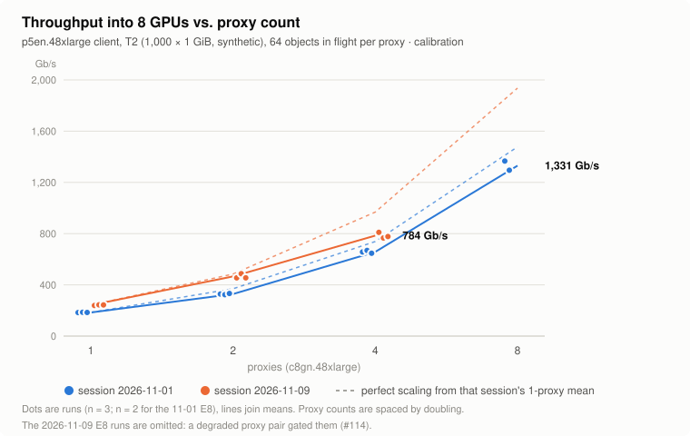
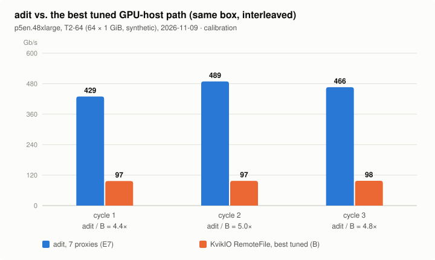
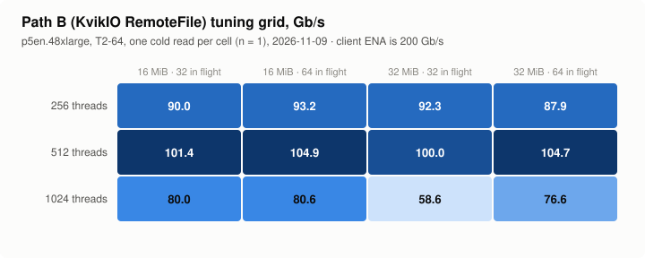
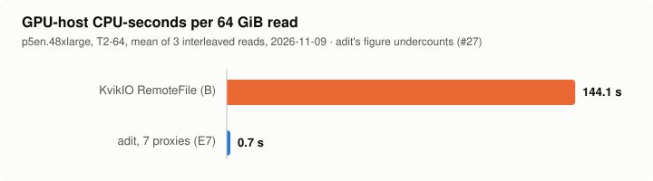

# Results so far

> **Calibration, not headline results.** Everything on this page is measured, but on synthetic
> data:
> - T2 is 1,000 random 1 GiB objects; T2-64 is its first 64.
> - The project's gate is still stopped by an open defect (#98).
> - GPU-host memory-traffic counters are not collected yet (#31).
> - Of the competing paths, only path B (KvikIO) has been run.
>
> Headline numbers will come from real workloads (R1–R6) on every path, in G3 (#123). Every
> chart is drawn from `bench/results/*.csv` by `bench/report/plots.py`; each row carries its full
> configuration.

## Throughput scales with proxy count

<picture>
  <source media="(prefers-color-scheme: dark)" srcset="img/scaling-dark.svg">
  
</picture>

| Proxies | 2026-11-01 (Gb/s, mean of runs) | 2026-11-09 (Gb/s, mean of runs) |
|---|---|---|
| 1 | 184.6 | 242.0 |
| 2 | 328.1 | 465.7 |
| 4 | 657.5 | 784.4 |
| 8 | 1,330.7 (n = 2) | omitted: gated by a degraded proxy pair (#114) |

**Setup:** one p5en.48xlarge client (8 × H200), c8gn.48xlarge proxies, T2, 64 objects in flight
per proxy. Rows: `paths-g261.csv` and `paths-g2117.csv`, `step=ladder`.

**Reading the chart:**
- At 8 proxies, adit delivered about 1.3 Tb/s. That is about 6.5× the client's 200 Gb/s ENA,
  and about 40% of its 3,200 Gb/s EFA.
- Efficiency against perfect scaling was 0.89–0.96 at 2 proxies and 0.81–0.89 at 4.
- The project's H-scale criterion (≥ 0.8 of linear up to 8) is not yet resolved at 8 (#48).

## adit against the best tuned GPU-host path

<picture>
  <source media="(prefers-color-scheme: dark)" srcset="img/ceiling-dark.svg">
  
</picture>

| Cycle | adit, 7 proxies (Gb/s) | KvikIO RemoteFile (Gb/s) | Ratio |
|---|---|---|---|
| 1 | 429.4 | 96.8 | 4.4× |
| 2 | 488.7 | 97.5 | 5.0× |
| 3 | 466.1 | 97.7 | 4.8× |

**Setup:** interleaved on the same box, on T2-64. KvikIO ran at its tuned best (512 threads,
16 MiB tasks, 64 in flight). Rows: `paths-g2117.csv`, `step=ceiling`.

**Caveats:**
- **adit's side is held down.** T2-64 is small enough that set-up and tail dominate, and 64
  objects don't divide evenly over 7 proxies. So these ratios understate adit at scale.
- **B's side may be too.** KvikIO reaches about half of the client's ENA, and why is still open
  (#54).

## Path B's tuning grid

<picture>
  <source media="(prefers-color-scheme: dark)" srcset="img/bgrid-dark.svg">
  
</picture>

Before it is compared, every path is tuned to its plateau (law 3).
- KvikIO peaks at 512 threads: 100.0–104.9 Gb/s across task sizes and in-flight counts.
- 1,024 threads is worse everywhere.
- Each cell is a single cold read. Rows: `paths-g2117.csv`, `step=bsweep`.

## GPU-host CPU per read

<picture>
  <source media="(prefers-color-scheme: dark)" srcset="img/cpu-dark.svg">
  
</picture>

| Path | GPU-host CPU-seconds per 64 GiB read (mean of 3) |
|---|---|
| KvikIO RemoteFile | 144.1 |
| adit, 7 proxies | 0.7 (undercounts; #27) |

The GPU host's cores are the job's cores. A path that spends them on fetching data takes them
from the work.
- **What adit's figure misses:** it undercounts the client's completion polling, which was
  measured separately at about 0.5 core per GB/s (#17).
- **What H-zero will add:** the memory-traffic side, measured (#31).

## Regenerating

```
python3 -I bench/report/plots.py
```

It writes `docs/img/<chart>-{light,dark}.svg` from the CSVs, with no dependencies.
